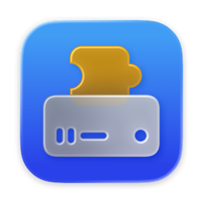

    

<h1 align="center">ACP Toaster</h1>

    A macOS app that detects local model servers and toasts their models
    into OpenCode ACP wrappers.

## How it works

- **Add a server** — give it a name, an address (loopback, LAN, or Tailscale
  with a port), and an icon.
- **Detect** — ACP Toaster probes the server in order: LM Studio, Ollama,
  then the generic OpenAI-compatible endpoint, and labels it by whichever
  answers.
- **Browse models** — each model shows its specs (params, quant, format, RAM,
  max context) and capabilities (vision, tool use, reasoning), with the
  server's ping refreshing every few seconds.
- **Toast** — writes an OpenCode ACP wrapper for the model and merges the
  provider entry into your OpenCode config. Delete a model's wrapper any
  time from the server's detail view.
